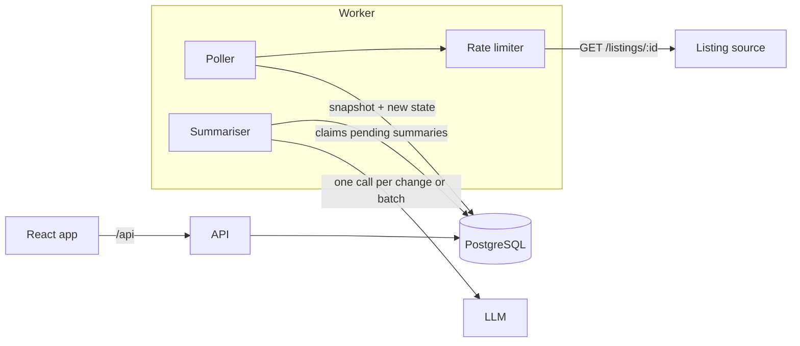

# CompetitorPulse

CompetitorPulse tracks competitor product listings over time. It polls each tracked
competitor on a schedule, decides whether the listing changed in a way that matters to a
product manager, and uses an LLM to explain the change in plain English. A small React
app shows the list of competitors and each competitor's history.

- [Run it](#run-it)
- [Try it](#try-it)
- [Configuration](#configuration)
- [How it works](#how-it-works)
- [Design decisions](#design-decisions)
- [Scaling to production](#scaling-to-production)
- [Not included yet](#not-included-yet)
- [API](#api)
- [Development and tests](#development-and-tests)
- [Deploy on Render](#deploy-on-render)
- [How it was built](#how-it-was-built)

## Run it

You need Docker.

```bash
git clone https://github.com/vetonmeqa/competitor-pulse.git
cd competitor-pulse
docker compose up --build
```

Then open **http://localhost:8080**.

This starts the whole system: PostgreSQL, a one-shot migration step, the API, the worker,
the web app, and a bundled listing source and mock LLM to run against. No `.env` file or
API key is needed.

| Service | Address | What it is |
| --- | --- | --- |
| `web` | http://localhost:8080 | The React app, served by nginx, which also forwards `/api` |
| `api` | http://localhost:3000 | The HTTP API |
| `worker` | no port | The poller and the summariser |
| `listing-source` | http://localhost:4002 | A simulated competitor website: slow, flaky and rate-limited on purpose |
| `mock-llm` | http://localhost:4001 | A mock LLM that speaks the OpenAI Chat Completions format |
| `db` | localhost:5432 | PostgreSQL 16 (user, password and database are all `pulse`) |

## Try it

Add a few competitors in the app. The bundled source knows `acme-crm`,
`north-analytics`, `ferry-pay`, `lumen-docs` and `orbit-hr`. Any other id is accepted too
and shows as "Not found at source".

In Docker each competitor is polled every 30 seconds. The source moves each competitor to
its next version every 120 seconds, so the first changes take a few minutes. To see them
sooner:

```bash
# Move every competitor to its next version now
curl -X POST localhost:4002/control/advance -d '{}'

# Or let the source do that every 20 seconds
curl -X POST localhost:4002/control/configure -d '{"versionIntervalSeconds": 20}'
```

To watch the failure handling, in the timeline and in the footer of the app:

```bash
# The next 3 LLM calls fail: summaries show "trying again shortly", then arrive
curl -X POST localhost:4001/control/configure -d '{"failNext": 3}'

# The LLM becomes slower than the 15 second timeout
curl -X POST localhost:4001/control/configure -d '{"latencyMs": 20000}'

# The source allows only 1 request per second: the backend slows itself down
curl -X POST localhost:4002/control/configure -d '{"rateLimitPerSecond": 1}'

# Back to normal
curl -X POST localhost:4001/control/reset && curl -X POST localhost:4002/control/reset
```

## Configuration

Every setting has a default. To change one, put it in a `.env` file next to
`docker-compose.yml` (see [.env.example](.env.example)) or set it in the shell.

| Setting | Default in Docker | Meaning |
| --- | --- | --- |
| `SOURCE_BASE_URL` | `http://listing-source:4002` | Where listings are fetched from |
| `SOURCE_RATE_LIMIT_PER_SEC` | `5` | The most requests per second sent to the source |
| `SOURCE_TIMEOUT_MS` | `10000` | Time allowed for one source request |
| `POLL_INTERVAL_SECONDS` | `30` | How often each competitor is polled. Production would use `900` |
| `LLM_PROVIDER` | `openai-compatible` | `openai-compatible` or `anthropic` |
| `LLM_BASE_URL` | `http://mock-llm:4001/v1` | Endpoint for the `openai-compatible` provider |
| `LLM_API_KEY`, `LLM_MODEL` | empty | Key and model for a real provider |
| `LLM_TIMEOUT_MS` | `15000` | Time allowed for one LLM call |
| `LLM_DAILY_CAP` | `2000` | Hard cap on LLM calls per UTC day |
| `LLM_MAX_ATTEMPTS` | `3` | Attempts per summary before giving up |
| `LLM_BATCH_SIZE` | `1` | Changes summarised per LLM call, 1 to 20 |
| `SUMMARY_MAX_AGE_HOURS` | `48` | A change older than this is no longer sent to the LLM |
| `RETENTION_DAYS` | `90` | How long snapshots are kept |

### Use a different data source

Set `SOURCE_BASE_URL`. For a source running on your own machine, outside Docker:

```bash
SOURCE_BASE_URL=http://host.docker.internal:4002 docker compose up --build
```

If your instance uses port 4002 or 4001 itself, the bundled copies would collide with
it. Start only the services you need:

```bash
SOURCE_BASE_URL=http://host.docker.internal:4002 \
LLM_BASE_URL=http://host.docker.internal:4001/v1 \
docker compose up --build db migrate api worker web
```

The backend only ever talks to the source over HTTP, so any service that answers
`GET /listings/:id` in the same shape can take its place.

### LLM providers

The **bundled mock LLM** is the default, so the system runs with no key. It echoes the
start of the prompt instead of writing a real summary. The prompt therefore leads with the
changed fields, which keeps the mock's output readable.

The LLM sits behind a small interface with two adapters, chosen by `LLM_PROVIDER`:

| Provider | Settings | Notes |
| --- | --- | --- |
| Mock LLM | none | The default |
| OpenAI, Ollama, or any Chat Completions endpoint | `LLM_BASE_URL`, `LLM_API_KEY`, `LLM_MODEL` | Same adapter as the mock |
| Claude | `LLM_PROVIDER=anthropic`, `LLM_API_KEY` | Uses the Anthropic SDK. `LLM_MODEL` defaults to `claude-opus-5-5`. `LLM_BASE_URL` is ignored |

**Not verified:** the Anthropic adapter and batching (`LLM_BATCH_SIZE` above 1) are
covered by tests against stub servers and a scripted model, but have not been run against
a real model. The mock cannot answer a batch, so keep the batch size at 1 with it.

## How it works



1. **The schedule is a column.** Each competitor has a `next_poll_at`. The poller takes
   the most overdue one, at the pace the rate limiter allows, and pushes its
   `next_poll_at` one interval ahead straight away.
2. **Each response is normalised** and compared with the competitor's last good listing.
3. **One transaction stores the poll:** the snapshot row and the competitor's new state.
   A change that needs the LLM is stored with a `pending` summary.
4. **The summariser is a separate loop.** It takes pending summaries, newest first,
   reserves a call from the daily cap, calls the LLM with a timeout, and stores the text.
5. **The API reads from the database only.** It never calls the source or the LLM.

The API and the worker are two processes from one image. The API is stateless. The
worker runs as a single instance, because the rate limiter lives in its memory; a
Postgres advisory lock enforces that, and a second worker waits as a standby.

Code map: [backend/src/domain](backend/src/domain) holds the rules with no I/O,
[backend/src/poller](backend/src/poller) the scheduler,
[backend/src/summarizer](backend/src/summarizer) the LLM side,
[backend/src/api](backend/src/api) the HTTP API, and [frontend/src](frontend/src) the
React app.

## Design decisions

### What counts as a change

Four fields are tracked: title, tagline, price and description. Everything else in the
response (`renderedAt`, `requestId`, `promoBanner`, `viewerCount`, `cache`) is ignored.

Before comparing, each value is normalised:

- **Text:** HTML entities are decoded, non-breaking spaces and runs of whitespace become
  one space, and the ends are trimmed.
- **Price:** parsed into amount, currency and period, then written in one form. `$29/mo`,
  `$29.00/mo`, `$29 / month` and `USD 29 per month` are the same price. So are `Free`,
  `$0/mo` and `Free forever`.

| The poll sees | Result |
| --- | --- |
| The first good listing | A baseline. Not a change, no summary |
| The same content | Not a change |
| Different content | A change, summarised by the LLM |
| The exact version from before the last change (A, B, A) | A change, labelled "Reverted", summarised by a fixed sentence |
| 404 after it was listed | A change, labelled "Delisted", fixed sentence |
| Listed again after a 404 | A change. Fixed sentence if the content is the same, LLM if it differs |
| A field missing, empty or null | Recorded as incomplete. Not compared, state untouched |
| 5xx, timeout, or a body that is not a listing | Recorded as a failed poll. State untouched |

A failed or incomplete poll never changes what the next good poll is compared with.

**Why the revert rule:** one of the sample competitors flips its tagline between two
values five times, which looks like an A/B test. Each flip is a real change, but it needs no LLM to
explain, and without the rule a single flapping competitor would drain the daily cap.

**Considered instead:**
- *Hashing the raw response.* Every poll would be a change, because of the noise fields
  and the format variants.
- *Letting the LLM decide what matters.* It costs a call per poll and gives a different
  answer on a different day. Deciding is cheap and deterministic in code; explaining is
  what the LLM is good at.
- *Not counting repeated flips as changes at all.* Quieter, but it hides something that
  did happen. I kept them as changes and made them cheap.

**Known limits:** a price that cannot be parsed (for example "Contact sales") is compared
as plain text, which can report a pure reformatting as a change. Text comparison is exact
after normalisation, so a change in case or punctuation counts. A field that a competitor
really removed would be reported as incomplete for ever.

### An id the source does not know

Adding it succeeds with `201`. The source cannot say in advance which ids exist, a 404
there can be temporary (a delisted competitor comes back), and a slow or failing source
should not make the add request slow or fail. A new competitor goes to the head of the
poll queue, so its timeline shows "The source does not list this competitor" within
seconds. A duplicate add returns `409`.

### Scheduler and rate limit

- **The queue is the `competitors` table.** Claiming uses `FOR UPDATE SKIP LOCKED`.
  Because the claim itself reschedules the competitor, a worker that dies mid-poll leaves
  nothing stuck.
- **Requests are evenly spaced:** at 5 per second, starts are at least 200 ms apart, with
  no bursts. Only the start is limited, so slow requests overlap and one hanging request
  does not hold up the rest.
- **A 429 is not a poll result.** The limiter pauses everything until `Retry-After`, and
  the competitor goes back to the head of the queue. No snapshot is stored.
- **The limiter tunes itself.** A 429 also cuts the rate by 30%; each accepted request
  raises it a little, up to the configured ceiling. If the source's real limit is lower
  than configured, the backend settles just under it.
- **No immediate retries** of failed polls. A retry costs rate budget, so the next
  scheduled poll is the retry.

**Considered instead:** a timer per competitor (no global rate control, and state lost on
restart); a Redis queue such as BullMQ (another service to run, for a queue that is one
indexed column); a token bucket with bursts (a burst is exactly what trips the source's
limit); a fixed rate with no tuning (measured below).

Measured against the bundled source, with the source set to allow 2 requests per second
and the backend still configured for 5:

| | Accepted per second | Rejected with 429 |
| --- | --- | --- |
| Fixed rate, pausing on each 429 (simulated, 10 min) | 1.43 | 33% of requests |
| Self-tuning (simulated, 10 min) | 1.81 | 1.7% |
| Self-tuning (real Docker stack, 60 s) | 1.83 | 3.5% |

### How the history is stored

- **One row per poll** in `snapshots`, including unchanged and failed polls, because the
  timeline shows those too.
- **Listing text is stored once per distinct version** in `listing_versions`. A snapshot
  points at a version, so an unchanged poll does not store the text again.
- **The snapshot row is also the summary job.** There is no separate queue table.
- **Retention** is an hourly delete of snapshots older than `RETENTION_DAYS`.

Measured on 200,000 sample rows: 102 bytes per snapshot row, or 210 bytes per poll
including indexes. A timeline query (one competitor, newest 100) took under 0.1 ms and
read the index in order.

**Considered instead:** storing the full listing on every poll (several times the size,
mostly duplicates); collapsing runs of identical polls into one row with a count (much
smaller, but individual fetch times are lost, and the timeline shows every poll,
including the unchanged ones).

Migrations use Drizzle: the schema is TypeScript, `drizzle-kit` generates plain SQL files
that are committed, and one command applies them.

### LLM summaries

**A poll result cannot be lost to the LLM.** The snapshot is committed before any LLM
call exists. Polling and summarising are separate loops.

What the user sees:

| Situation | In the timeline |
| --- | --- |
| The LLM answers | The summary, marked "AI summary" |
| The LLM is slow | The call is cut off at the timeout. "The last attempt failed because the AI service took too long to answer. Trying again shortly." |
| The LLM fails, or returns something empty or far too long | Retried after 15 s and again after 60 s, then "No summary: ..." with the cause |
| The daily cap is reached | No call is made. "The daily AI summary budget is used up. This summary will be generated after the budget resets at 00:00 UTC." |
| The LLM is down (5 failures in a row) | Calls stop. "The AI service is not responding. This summary will be generated when it recovers." One test call after 30 s, then at doubling intervals up to 5 minutes |

In every case the snapshot shows **what changed, field by field, with the before and
after values**. That comes from the stored versions and never depends on the LLM. The API
returns a `summaryReason` with a code and a message whenever `summary` is null.

**The daily cap** is a counter per UTC day in the database, reserved in one atomic
statement before each call. Every attempt counts, including failed ones, because a
request that was sent may have been billed. What stretches the cap:

- **Fixed sentences** for reverts, delistings and unchanged relistings cost nothing.
- **Newest first.** When the budget is short, fresh changes get it.
- **The circuit breaker** stops an outage from burning the budget on retries. A full day
  of outage costs about 290 calls, not three attempts for every change.
- **Expiry.** A change nobody could summarise within 48 hours is given up on.
- **Batching** (`LLM_BATCH_SIZE`, off by default). The cap counts calls, not changes, so
  10 changes per call turn 2,000 calls into as many as 20,000 summaries. A call takes
  whatever is pending at that moment and never waits to fill a batch. Each entry of the
  answer is judged on its own, and a bad entry is retried alone.

**Considered instead:** calling the LLM inside the poll (a slow LLM would stall polling,
and a crash between the two would lose one of them); spreading the budget evenly across
the day (it delays summaries even while budget is plentiful, see below); filling in a
fixed sentence when the LLM fails (the field-by-field changes already say it, and a
generated-looking sentence would hide that the LLM failed).

Listing text is third-party content that goes into a prompt, so the system prompt tells
the model to treat it as data and not to follow instructions inside it.

### Removing a competitor

It deletes the competitor and its history. Adding it again starts fresh. The app asks for
confirmation first, and points to pausing as the way to keep the history.

### Pausing a competitor

Pausing stops the polling and keeps everything else: the history, the current state and
the "changed in the last 24 hours" flag. Resuming continues from there.

- **One nullable column,** `paused_at`. The poller only takes competitors where it is
  empty.
- **The poll queue index leaves paused competitors out.** A paused competitor stays "due"
  for ever. In a plain index the poller would read past every one of them on each claim.
  Measured with 1,000 paused among 6,000: the claim reads 1 row, where a plain index reads
  1,001.
- **Resuming polls at once.** The competitor goes to the head of the queue, as a new one
  does, so the gap in its history ends within seconds.
- **Both calls can be repeated.** Pausing twice keeps the first pause time. Resuming a
  competitor that is not paused leaves its place in the queue alone.
- **Paused competitors are not behind schedule.** The status endpoint counts them
  separately and leaves them out of the queue lag.
- **The list can show active competitors only,** filtered by the server like the search.

**Known limits:** a poll already in flight when the pause arrives is still recorded.
Retention keeps running, so a competitor paused for more than 90 days ends with an empty
history. A summary that was pending is still written.

### The competitor list: paging and search

- **The server pages and searches.** The list returns one page (25 competitors, at most
  100), so the response and the 5-second refresh stay the same size at 6,000 competitors
  as at 5.
- **Search looks at every tracked competitor,** not at the rows on screen. It matches the
  id and the current title, in any letter case. `%` and `_` in the search text are plain
  characters.
- **The response body stays a plain array of competitors.** The counts travel in response
  headers: how many competitors match and how many are tracked, for "12 of 6,000
  competitors" and "Showing 26–50 of 312".
- **A page past the end returns the last page.** That happens in normal use: the only
  competitor on the last page is removed. The `X-Page` header says which page it is.
- **The page and the search are in the URL,** so a view can be bookmarked and the back
  button works.
- **The timeline reads its competitor from `GET /api/competitors/:id`,** because the
  competitor may not be on the page of the list that is loaded.

**Considered instead:** a cursor ("load more" after the last id). It stays fast on any
table size and no row shifts when another is added, but it has no page numbers, and the
refresh would have to re-fetch every page loaded so far. Skipping rows by offset costs
more the deeper the page, which does not matter here: the last page of 6,000 takes about
15 ms. The timeline, on a table with millions of rows, does use a cursor (next section).

**Known limits:** the search reads every competitor row, which is fine for thousands. At
a much larger size it would need a trigram index. A competitor added or removed while
someone is paging moves the rows after it by one place.

### The timeline: older snapshots by cursor

- **The timeline loads 50 snapshots,** and "Show older snapshots" asks for the 50 before
  the last one shown: `?before=<snapshot id>`. The whole 90 days can be reached this way,
  and the response stays a plain array.
- **The query jumps to its place in the index.** It compares the pair (time, id) with the
  cursor's, which the timeline index answers directly. Measured on 208,000 rows, for 50
  snapshots that are 8,000 deep in one competitor's history: 13 pages read in 0.09 ms.
  The same rows by offset: 865 pages and 2.9 ms, growing with the depth.
- **Polls that arrive meanwhile do not shift anything,** because a page is defined by the
  snapshot before it and not by a position.
- **The end of the history is a page that is not full.** When the last page happens to be
  full, one more request returns nothing.

**Known limit:** the 5-second refresh fetches every loaded page again, one small request
each, so the list never has a gap or a repeat. Someone who has loaded 20 pages causes 20
requests per refresh. Refreshing only the newest page would be cheaper, but a summary
still pending on an older page would then stop updating.

## Scaling to production

The design target is 6,000 tracked competitors, each polled every 15 minutes, against a
source that allows 5 requests per second, with at most 2,000 LLM calls a day and 90 days
of history. Taken together, those targets ask for more than the source and the LLM budget
allow. For each one, this is what the system does today and what I would change.

**1. Polling.** 6,000 competitors every 15 minutes is 6.67 requests per second. The
source allows 5.

What happens today: nothing breaks. The poller always takes the most overdue competitor,
so every competitor is polled equally often and the cycle stretches to 6,000 / 5 = 20
minutes. I ran the same shape on a small scale (46 competitors needing 9.2 requests per
second against a limit of 5): the backend sent 4.95 per second, was never rejected,
polled every competitor 4 or 5 times in the window, and reported how far behind it was.

What I would do, in this order:
- Ask whether the limit can be raised. Going from 5 to 7 per second closes the gap.
- Tier the competitors. The ones a product manager watches closely keep 15 minutes; the
  long tail gets 30 or 60.
- Adapt the interval to how often each listing changes. Most rarely do.

I did not build tiering, because it gives up the 15-minute target for part of the list,
and that should be a product decision.

**2. LLM calls.** At 5 requests per second there are up to 432,000 polls a day. If only
0.5% of them are changes that need the LLM, that is 2,160 calls, already over 2,000.

What happens today: the measures under [LLM summaries](#llm-summaries) (fixed sentences,
newest first, the breaker, expiry), and beyond the cap, changes are still shown with
their before and after values and their summaries wait for the reset. With a real model,
batching is the large lever.

What I would add: merge several pending changes of one competitor into one summary, and
rank by importance (a price change before a reworded description). I would not spread
the budget evenly over the day without data on when changes arrive.

**3. History.** 6,000 competitors over 90 days is 38.9 million polls at the achievable
20-minute cycle, or 51.8 million at 15 minutes. At the measured 210 bytes per poll that
is about 8 to 10 GB.

That fits in one PostgreSQL table with the current indexes. What I would change before
production is retention: partition `snapshots` by month and drop whole partitions,
because deleting half a million rows a day from one table causes bloat and vacuum load.

**4. One worker.** 5 requests per second is nowhere near CPU-bound, so one worker is
enough, and the standby gives failover. Many workers would need a shared rate limiter.

## Not included yet

These are outside the current scope. Each would be a good addition.

- **Authentication.** It is an internal tool for a single user.
- **Tiered or adaptive polling, budget pacing, merging pending summaries.** Described
  above.
- **Table partitioning.** Described above.
- **Cleaning up listing versions** that no snapshot references any more after retention.
  They are small, and are removed with their competitor.
- **A shared package for the API types.** The frontend mirrors them by hand in
  [frontend/src/api/types.ts](frontend/src/api/types.ts).
- **Live updates over SSE or WebSockets.** The app refreshes every 5 seconds.
- **Metrics and alerting.** `GET /api/status` and structured logs are there; a metrics
  endpoint is not.
- **CI and a running cloud deploy.** [render.yaml](render.yaml) is an example only; see
  [Deploy on Render](#deploy-on-render).

Known gaps in verification: the frontend was checked in Chrome at phone, tablet and
desktop widths, not on physical phones or in Safari and Firefox, and no automated
accessibility audit was run. `npm audit` reports findings in development tools only
(the test runner); the runtime dependencies of both projects have none.

## API

```
GET    /api/competitors                      -> [Competitor, ...]   one page, by id
GET    /api/competitors/:id                  -> Competitor, or 404
POST   /api/competitors      { "id": string } -> 201, or 409 if tracked, 400 if invalid
DELETE /api/competitors/:id                  -> 204, or 404
POST   /api/competitors/:id/pause            -> Competitor, or 404
POST   /api/competitors/:id/resume           -> Competitor, or 404
GET    /api/competitors/:id/snapshots        -> [Snapshot, ...]   newest first
GET    /api/status                           -> queue lag, LLM usage, worker state
GET    /api/health                           -> { "ok": true }
```

`competitors` accepts `?page=` (from 1), `?pageSize=` (default 25, at most 100), `?q=`,
which keeps the competitors whose id or current title contains the text, and
`?activeOnly=true`, which leaves out the paused ones. The counts are in response headers:

| Header | Meaning |
| --- | --- |
| `X-Total-Count` | Competitors that match `q` and `activeOnly` |
| `X-Total-Tracked` | All tracked competitors |
| `X-Page` | The page returned: the last one when the page asked for is past the end |
| `X-Page-Size` | The page size used |

`snapshots` accepts `?limit=` (default 100, at most 1000), `?changedOnly=true` and
`?before=<snapshot id>`, which returns only the snapshots older than that one.

A snapshot looks like this:

```jsonc
{
  "id": 42,
  "fetchedAt": "2026-09-10T12:00:00.000Z",
  "status": "ok",              // ok | not_found | incomplete | error
  "statusDetail": null,        // e.g. "timeout", "http_503", "missing:price"
  "title": "Acme CRM",         // the four listing fields are null unless status is ok
  "tagline": "Simple CRM for small teams",
  "price": "$29/mo",
  "description": "Track leads & deals in one place.",
  "changed": true,
  "changeKind": "content",     // initial | content | revert | delisted | relisted | null
  "changes": [{ "field": "price", "before": "$39/mo", "after": "$29/mo" }],
  "summary": "Price dropped from $39/mo to $29/mo.",
  "summaryStatus": "done",     // none | pending | done | failed
  "summarySource": "llm",      // llm | template | null
  "summaryReason": null        // { code, message } whenever summary is null
}
```

A competitor has `id`, `createdAt`, `availability` (`unknown`, `listed` or `delisted`),
`title`, `lastPolledAt`, `lastPollStatus`, `lastChangedAt`, `changedInLast24h` and
`pausedAt` (null while it is being polled).

## Development and tests

You need Node 22 and Docker. Start only the infrastructure, then run the three parts
yourself:

```bash
docker compose up -d db listing-source mock-llm

cd backend && npm install && npm run db:migrate
npm run dev:api                                  # http://localhost:3000
POLL_INTERVAL_SECONDS=10 npm run dev:worker      # in a second terminal

cd frontend && npm install && npm run dev        # http://localhost:5173
```

Backend settings for this mode are in [backend/.env.example](backend/.env.example).

| Command | Where | What it runs |
| --- | --- | --- |
| `npm test` | `backend` | 192 unit tests. No database needed |
| `npm run test:integration` | `backend` | 174 tests against PostgreSQL, in a separate `pulse_test` database |
| `npm test` | `frontend` | 110 component and page tests against a stubbed API |
| `npm run typecheck`, `npm run lint` | both | Strict TypeScript and type-aware lint rules |
| `npm run db:generate` | `backend` | Writes a new migration after a schema change |

Beyond the automated tests, each part was run against the bundled source and mock LLM
using their control endpoints, and the full Docker stack was put through these scenarios: more work
than the rate limit allows, a rate limit lowered without notice, forced source failures,
a slow LLM, a failing LLM, the daily cap, a database restart, and an API container being
replaced.

## Deploy on Render

[render.yaml](render.yaml) is an example [Render](https://render.com) Blueprint: the same
system as `docker-compose.yml`, on managed services. No code changes are needed for it.

**Not verified:** the blueprint was written against Render's documentation. It has not
been deployed.

| In Docker Compose | On Render | Notes |
| --- | --- | --- |
| `db` | Render Postgres 16 | `DATABASE_URL` is its private-network address |
| `migrate` | Pre-deploy command of the API | `node dist/db/migrate.js`, before each new version starts |
| `api` | Web service, from [backend/Dockerfile](backend/Dockerfile) | Listens on the `PORT` that Render sets. Health check on `/api/health` |
| `worker` | Background worker, the same image | `node dist/main-worker.js`, one instance |
| `web` | Static site | Two rewrite rules replace nginx: `/api/*` goes to the API, every other path to `index.html` |
| `listing-source`, `mock-llm` | Not included | See below |

To use it:

1. In Render, choose **New > Blueprint** and pick this repository.
2. Fill in the values Render asks for. They are the ones that do not belong in a file:
   `SOURCE_BASE_URL`, and `LLM_BASE_URL`, `LLM_API_KEY` and `LLM_MODEL` for an OpenAI
   compatible endpoint. For Claude, change `LLM_PROVIDER` to `anthropic` in `render.yaml`
   and fill in only `LLM_API_KEY`.
3. Check the address Render gave the API. A service name that is already taken gets a
   suffix. If that happened, put the real address in the `/api/*` rewrite rule.
4. Open the address of `competitor-pulse-web`.

What to know before using it:

- **The source and the LLM.** The worker needs a source it can reach over HTTP. To try
  the system with the bundled servers, run each as a Render private service
  (`node listing-source-server.mjs` and `python3 mock-llm-server.py`; both listen on
  `PORT`) and use their internal addresses for `SOURCE_BASE_URL` and `LLM_BASE_URL`. The
  LLM address ends in `/v1`.
- **No authentication.** The API has none, so anyone with the address can add and remove
  competitors. Put it behind access control before real use. `LLM_DAILY_CAP` still limits
  the LLM calls.
- **Cost.** The API, the worker and the database are paid instances; the static site is
  free. The free plan does not fit: it has no background workers and no pre-deploy
  command.
- **Schema changes.** The migration runs before the new API starts, but the worker is
  deployed at the same time and can start before the migration has finished. For a release
  with a schema change, deploy the API first.
- **Poll interval.** The blueprint sets `POLL_INTERVAL_SECONDS` to `900`, the production
  value, not the `30` used in Docker.

## How it was built

- **Design before code.** The data model, the scheduling model and the handling of LLM
  failures were settled before implementation started. [Design decisions](#design-decisions)
  records each choice together with the alternatives that were rejected and why.
- **Small steps, each one finished.** The system was built in order, from the schema up
  to the Docker stack. Every step was reviewed, verified and committed on its own before
  the next one began.
- **Measured, not assumed.** The figures in this document come from measurements: the
  rate limiter's settings from a simulation of the source's own algorithm, the storage
  size from 200,000 sample rows, and the queue's behaviour from giving it more work than
  the rate limit allows.
- **Tested by breaking it.** Automated tests cover the rules, the database behaviour and
  the UI. On top of that, the full stack was run through failure scenarios: a source that
  fails, stalls and lowers its limit, an LLM that is slow or down, an exhausted budget,
  and a database restart.
- **AI tool.** Claude Code was used as an AI tool for implementation and tests.
